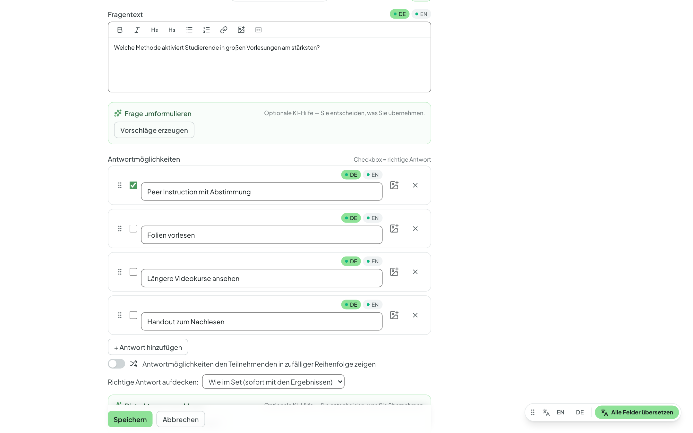
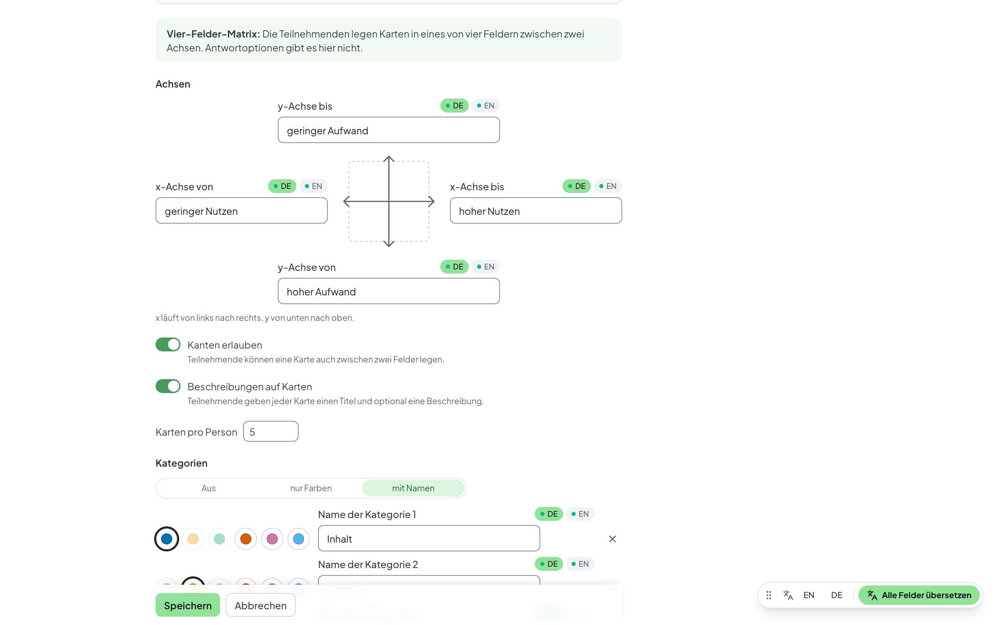

# Fragen erstellen

Innerhalb eines [Raums](raeume.md) legen Sie ein oder mehrere **Fragensets**
an — etwa eines je Sitzung. Ein Fragenset ist das, was Sie später
präsentieren oder freigeben.

## Art und Einstellungen des Fragensets

Beim Anlegen wählen Sie die **Art** des Fragensets — **Live-Umfrage**,
**Quiz-Block** oder **Lernkontrolle**. Sie legt fest, wie das Set
durchgeführt wird und welche Fragetypen möglich sind; Einzelheiten und
Einsatzbeispiele stehen unter [Arten von Fragensets](set-arten.md).

Über das Menü **⋮** des Sets → **Einstellungen** ändern Sie Titel,
Beschreibung und (im Experten-Modus) unter **Antworten & Ergebnisse** das
Verhalten des Sets — welche Optionen es gibt, hängt von der Art ab. Unter dem
Titel des Sets fasst eine Zeile die wichtigsten Einstellungen zusammen.

## Abschnitte (Experten-Modus)

Längere Sitzungen gliedern Sie in **Abschnitte**. Klicken Sie im Set auf
**Abschnitte**: Mit **„+ Abschnitt hier“** fügen Sie eine Überschrift ein, ein
Klick auf den Namen benennt sie um, am Griff verschieben Sie sie; Fragen
ziehen Sie unter die passende Überschrift. Jedem Abschnitt können Sie
optional eine **Beschreibung** geben. In der Präsentation erscheint vor dem
Abschnitt eine **Zwischenfolie** mit Titel und Beschreibung (nur am Beamer,
nicht bei den Teilnehmenden); mit ++s++ oder ++arrow-right++ rufen Sie die
erste Frage des Abschnitts auf.

## Eine Frage anlegen

Eine neue Frage legen Sie im Set über **„+ Neue Frage“** an. Das Menü ordnet
die Fragetypen danach, **was Ihre Teilnehmenden tun** — so hat jeder Typ genau
einen Platz. Es zeigt nur die Typen, die die Art des Sets erlaubt.

### Auswählen

Teilnehmende wählen aus vorgegebenen Antworten.

- **Einzelauswahl** — genau eine Antwort wählbar; eine richtige Antwort lässt
  sich markieren.
- **Mehrfachauswahl** — mehrere Antworten gleichzeitig möglich.
- **Ja/Nein** — zwei Antworten; wählen Sie die Vorlage **Ja/Nein** oder
  **Wahr/Falsch**, oder geben Sie eigene ein.

### Bewerten & Ordnen

Teilnehmende bewerten, gewichten oder ordnen.

- **Likert-Skala** — Zustimmung auf einer festen, geordneten Skala (z. B.
  „trifft zu“ bis „trifft nicht zu“), auf Wunsch mit Enthaltung.
- **Prioritäten** — Ihre Teilnehmenden verteilen bis zu **100 Punkte** auf
  die Antworten: je wichtiger, desto mehr Punkte. Die Auswertung zeigt je
  Antwort den Durchschnitt (mit Minimum und Maximum), absteigend sortiert — so
  sehen Sie, was der Gruppe am wichtigsten ist. Eine „richtige“ Antwort gibt
  es nicht.
- **Sortierung** — Ihre Teilnehmenden bringen Elemente per Ziehen und Ablegen
  in die richtige Reihenfolge. Die Reihenfolge, in der Sie die Elemente im
  Editor speichern, ist die Lösung; Teilnehmende sehen sie gemischt. Die
  Auswertung zeigt, wie viele die Reihenfolge **komplett richtig** sortiert
  haben, und für je zwei aufeinanderfolgende Elemente, wie oft sie **direkt in
  Folge** einsortiert wurden — so erkennen Sie, welche Übergänge
  Schwierigkeiten machen.

### Offen antworten

Teilnehmende antworten in eigenen Worten — auch, um gemeinsam Ideen zu
sammeln.

- **Freitext** — offene Antworten (bis 500 Zeichen), angezeigt als Liste.
  Optional mit **Musterlösung** und KI-Auswertung (siehe
  [KI-Assistenz](ki-assistenz.md)).
- **Wortwolke** — kurze Begriffe, die live zu einer Wolke wachsen (gleiche
  Wörter werden zusammengefasst, auch bei unterschiedlicher Groß- und
  Kleinschreibung). Einstellbar sind die **Anzahl der Beiträge pro Person**,
  ob mehrere Begriffe **gesammelt und gemeinsam abgeschickt** werden (bis zu
  fünf Felder auf einmal) und ob die Wolke **schon während der Abstimmung**
  auf dem Beamer wächst oder erst nach dem Schließen erscheint.
- **Mindmap** — Teilnehmende bauen gemeinsam einen Begriffsbaum auf; gleiche
  Begriffe werden mit Anzahl zusammengefasst. Einstellbar sind die **Tiefe**,
  die Anzahl der **Begriffe pro Person**, Titel + Beschreibung sowie
  **vorgegebene Äste**. Optional folgt eine **Bewertungsphase** (Punkte oder
  Plus/Minus, siehe [Präsentieren](praesentieren.md#mindmap)). Nur in
  Live-Umfragen möglich.
- **Vier-Felder-Matrix** — Teilnehmende legen Karten auf ein
  Koordinatenkreuz mit zwei Achsen, z. B. „wenig/viel Aufwand“ gegen
  „wenig/viel Nutzen“. Nur in Live-Umfragen möglich; Einzelheiten unten.

### Die Vier-Felder-Matrix einrichten

Sie beschriften beide Enden beider Achsen (zweisprachig möglich); die Felder
heißen oben rechts, oben links, unten links und unten rechts. Einstellbar
sind:

- **Kanten erlauben** — Karten dürfen auch auf den Achsenlinien liegen, also
  zwischen zwei Feldern.
- **Beschreibungen auf Karten** — zusätzlich zum Titel.
- **Karten pro Person**.
- **Kategorien**: *aus*, *nur Farben* (bis zu sechs Farben, die Sie frei aus
  der Palette wählen; auf Smartphone und Beamer als Buchstaben A–F nach
  Reihenfolge benannt) oder *mit Namen* (Farbe plus Name, z. B. „Präsenz“ und
  „Digital“). Mindestens zwei Kategorien sind nötig.
- eine optionale **Bewertungsphase** — Punkte oder Plus/Minus mit Budget pro
  Person, auf Wunsch mehrere Punkte pro Karte und Anzeige der Zwischenstände
  während der Bewertung.
- **KI-Funktionen aktivieren** — für das
  [KI-Zusammenfassen](praesentieren.md#ki-zusammenfassen-experten-modus) am
  Beamer.

Teilnehmende wählen auf dem Smartphone ein Feld (die „+“-Flächen), geben Titel
(und ggf. Beschreibung und Kategorie) ein und sehen unter „Ihre Karten“, wie
viele sie noch setzen dürfen; eigene Karten lassen sich dort löschen.

## Lösung und weitere Einstellungen je Frage

Bei Auswahlfragen markieren Sie die richtige(n) Antwort(en). Ob und wann die
Lösung angezeigt wird, legen Sie je Set fest und können es je Frage
überschreiben: **sofort**, **nach dem Schließen** der Frage oder **nie**.

- **Zufällige Reihenfolge** — mischt die Antworten für jede Präsentation neu;
  alle Teilnehmenden sehen dabei dieselbe Reihenfolge.
- **Zeitbegrenzung** — schließt die Abstimmung automatisch nach der gewählten
  Zeit.
- **Bilder** — fügen Sie über das Bild-Symbol der Werkzeugleiste (oder per
  Ziehen) Bilder in den Fragetext ein; auch jede Antwort kann ein eigenes Bild
  erhalten.

## Zweisprachige Inhalte (Experten-Modus)

Fragen, Antworten, Titel und Beschreibungen können Sie auf **Deutsch und
Englisch** hinterlegen (Sprach-Reiter **DE · EN** am Feld). Wie das geht und
was Teilnehmende dann sehen, beschreibt
[Zweisprachigkeit](zweisprachigkeit.md).

## Vorher-Nachher-Fragen (Experten-Modus)

Mit einer Vorher-Nachher-Frage stellen Sie **dieselbe Frage zweimal** — etwa
zum Einstieg und noch einmal nach Ihrer Erklärung oder einer Diskussion — und
zeigen beide Ergebnisse direkt nebeneinander. So werden Lernfortschritte oder
Meinungsänderungen sichtbar.

Möglich ist das bei **Einzelauswahl** (auch Ja/Nein), **Mehrfachauswahl** und
**Likert-Skala**.

**So legen Sie eine an:**

1. Erstellen Sie die Frage wie gewohnt — sie wird die **Vorher-Frage**.
2. Öffnen Sie in der Fragenliste das Zeilenmenü **⋮** dieser Frage und wählen
   Sie **„Nachher-Frage hinzufügen“**.
3. Abstimmbar legt eine Kopie am **Ende des Sets** an. Ziehen Sie sie an die
   Stelle, an der Sie die Frage erneut stellen möchten — z. B. hinter den
   Abschnitt mit Ihrem Input.

Beide Fragen tragen in der Liste die Kennzeichen **Vorher** und **Nachher**.
Den Inhalt bearbeiten Sie nur an der Vorher-Frage; die Nachher-Frage
übernimmt jede Änderung automatisch (sie zeigt eine schreibgeschützte
Vorschau mit dem Link **„Vorher-Frage öffnen“**). Löschen Sie die
Vorher-Frage, wird die Nachher-Frage mitgelöscht. Jede Frage kann nur eine
Nachher-Frage haben.

**In der Präsentation** stellen Sie beide Fragen wie jede andere. Zeigen Sie
die Ergebnisse der Nachher-Frage, steht bei jeder Antwort das
Vorher-Ergebnis als hellerer Balken über dem Nachher-Ergebnis, bei einer
Likert-Skala die Vorher-Verteilung gedämpft über der neuen. **Auf der
Ergebnisseite** erscheinen beide Ergebnisse ebenfalls gegenübergestellt,
gekennzeichnet mit **Vorher** und **Nachher**. Die Stimmen werden getrennt
gezählt.

## Fragen wiederverwenden

- **Fragen aus einem anderen Set übernehmen** (Menü ⋮ des Sets) — wählen Sie
  Fragen aus Ihren anderen Sets und kopieren Sie sie hierher. Fragetypen, die
  die Art des Sets nicht erlaubt, sind gekennzeichnet.
- **In ein anderes Set kopieren** oder **verschieben** — über das Zeilenmenü
  einer Frage.
- **Duplizieren** (Experten-Modus) — kopiert das ganze Set, auch in einen
  anderen Ihrer Räume; so verwenden Sie es z. B. im nächsten Semester wieder.
- **Export (JSON)** (Experten-Modus) — speichert das Set als Datei. Im Raum
  holen Sie eine solche Datei über das Menü ⋮ → **Fragenset importieren (JSON)** wieder
  herein, etwa auf einer anderen Abstimmbar-Instanz.
- **Set kopieren (Freigabe-Link)** (Experten-Modus) — erzeugt einen Link, mit
  dem Kolleginnen und Kollegen eine Kopie des Sets **in ihren eigenen Raum**
  übernehmen können; Ihr Original bleibt unverändert. Optional geben Sie eine
  **Lizenz für die Weitergabe** an (z. B. CC BY 4.0). Wer gemeinsam am selben
  Set arbeiten möchte, teilt stattdessen den Raum (siehe
  [Räume im Team](team.md)).
