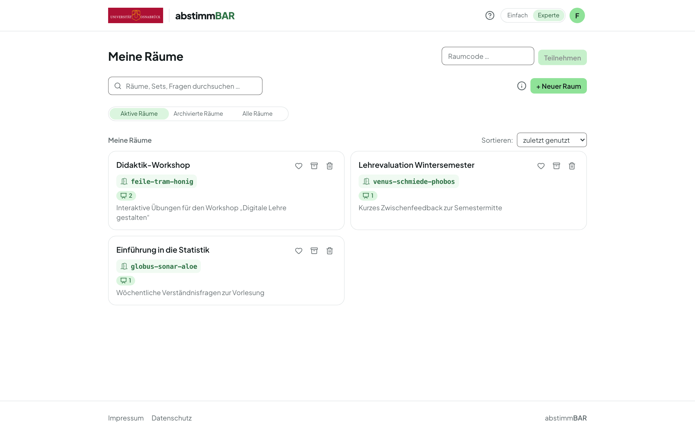

# Anleitung für Lehrende

Abstimmbar ist ein anonymes Live-Abstimmungssystem für Ihre Lehre. Sie stellen
Fragen, Ihre Teilnehmenden antworten mit dem eigenen Smartphone oder Laptop —
ganz ohne Anmeldung — und die Ergebnisse erscheinen sofort auf dem Beamer.

Diese Anleitung führt Sie von der Anmeldung bis zur Auswertung. Als
angemeldete Lehrperson können Sie außerdem jederzeit einen
[geführten Rundgang](rundgang.md) durch die Oberfläche starten — über das
**?**-Symbol oben rechts in der Kopfzeile.

## Kapitel

-   :material-login: **[Anmelden und Modus](anmelden.md)**

    Single Sign-on, einfacher und Experten-Modus, Sprache und Design.

-   :material-map-marker-path: **[Der geführte Rundgang](rundgang.md)**

    Alle wichtigen Funktionen in wenigen Minuten, am Beispielraum.

-   :material-door: **[Räume](raeume.md)**

    Der dauerhafte Zugang für Ihre Veranstaltung — mit festem Code.

-   :material-shape-outline: **[Arten von Fragensets](set-arten.md)**

    Live-Umfrage, Quiz-Block oder Lernkontrolle — was wann passt.

-   :material-pencil-box-multiple: **[Fragen erstellen](fragen.md)**

    Abschnitte, zehn Fragetypen, Vorher-Nachher, Import und Export.

-   :material-creation: **[KI-Assistenz](ki-assistenz.md)**

    Optionale Vorschläge — Sie entscheiden, was Sie übernehmen.

-   :material-play-circle: **[Durchführung starten](durchfuehrung.md)**

    Präsentieren, Quiz starten, Lernkontrolle veröffentlichen.

-   :material-qrcode: **[Teilnehmende einladen](teilnehmende.md)**

    QR-Code, Raumcode und was Teilnehmende sehen.

-   :material-projector-screen: **[Präsentieren](praesentieren.md)**

    Steuerung am Beamer, Wortwolke, Mindmap, Vier-Felder-Matrix.

-   :material-video: **[Aufgezeichnete Vorlesungen](aufzeichnung.md)**

    Nachträglich abstimmen über einen QR-Code je Frage.

-   :material-chart-bar: **[Ergebnisse](ergebnisse.md)**

    Durchführungen, CSV-Export, archivieren und löschen.

-   :material-account-group: **[Räume im Team](team.md)**

    Räume gemeinsam bearbeiten und präsentieren.

-   :material-school: **[In der Lernplattform](lms.md)**

    Aus Moodle heraus starten (Stud.IP, sobald dort LTI 1.3 verfügbar ist).

-   :material-translate: **[Zweisprachigkeit](zweisprachigkeit.md)**

    Oberfläche und Inhalte auf Deutsch und Englisch.

-   :material-shield-check: **[Datenschutz](datenschutz.md)**

    Anonym by design — und was die KI zu sehen bekommt.

Zum Schluss: [Tipps für die Lehre](tipps.md).
