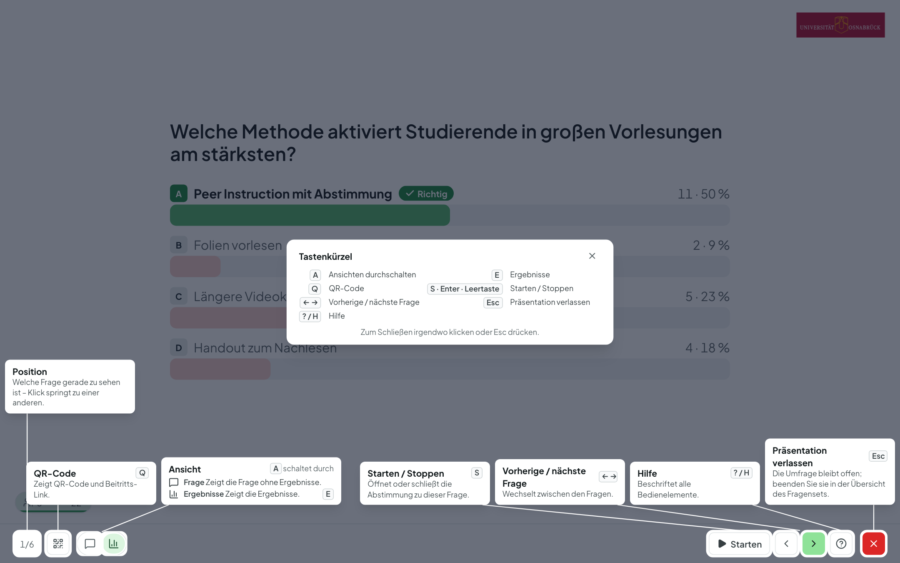
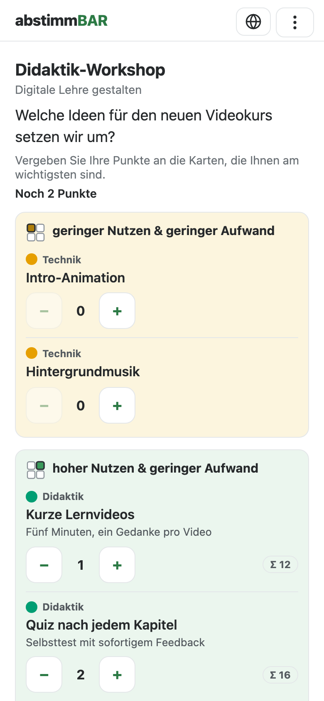

# Präsentieren

Im Präsentationsmodus steuern Sie die Sitzung über die Symbolleiste am
unteren Rand oder per Tastatur. Die Leiste zeigt nur, was gerade passt;
fahren Sie mit der Maus über ein Symbol, nennt ein Tooltip seinen Namen und
seine Taste.

## Die Fußleiste

- Links steht die **Position** (z. B. „3/12“). Ein Klick darauf öffnet eine
  Liste aller Fragen, aus der Sie **direkt zu einer anderen Frage springen**.
- Daneben öffnet das **QR-Symbol** (++q++) QR-Code und Raumcode jederzeit
  wieder.
- **Starten** (++s++, auch ++enter++ oder Leertaste — praktisch mit einem
  Presenter) öffnet die Abstimmung zur aktuellen Frage, **Stoppen** (++s++)
  schließt sie. Bis Sie starten, sehen die Teilnehmenden nur die Frage.
- **‹ ›** bzw. ++arrow-left++ ++arrow-right++ wechseln zur vorigen bzw.
  nächsten Frage.
- Rechts außen öffnet **?** (++h++) die [Hilfe](#hilfe), das rote **✕**
  (++esc++) [verlässt die Präsentation](#verlassen-oder-beenden).

Unten links zeigt eine kleine Anzeige die **verbundenen Teilnehmenden** und
die **abgegebenen Stimmen**. Ein farbiger Ring zeigt den Anteil, der schon
geantwortet hat: rot unter 50 %, gelb bis 80 %, hellgrün bis 95 %,
dunkelgrün darüber; haben alle geantwortet, leuchtet er kurz auf.

## Ansichten: Frage, Ergebnisse, Lösung

Mit dem **Ansichts-Schalter** neben dem QR-Symbol legen Sie fest, was der
Beamer zeigt: die **Frage**, die **Ergebnisse** und – falls die Frage eine
richtige Antwort hat und die Lösung „nach dem Schließen“ erscheinen soll –
die **Lösung**. Wortwolken, Freitext und Mindmaps bringen hier ihre eigenen
Darstellungen mit (z. B. Original, Aufgeräumt und Gruppiert, Bewertung oder
Rangliste). Die Ergebnisse aktualisieren sich **in Echtzeit**; die Balken
bauen sich kurz animiert auf, jede Antwort hat ihre eigene Farbe. Bei der
Lösung wird die richtige Antwort **grün** und mit „Richtig“ markiert, die
übrigen werden zart rosé.

- ++e++ springt zu den Ergebnissen (und schließt dabei eine laufende
  Abstimmung); ein weiteres ++e++ kehrt zur Frage zurück.
- ++l++ blendet die Lösung ein, ein erneutes ++l++ wieder aus.
- ++a++ schaltet die Ansichten der Reihe nach durch. ++a++ ist eine reine
  „Ansehen“-Taste: Eine laufende Abstimmung schließt sie nie.

Bei [Vorher-Nachher-Fragen](fragen.md#vorher-nachher-fragen-experten-modus)
stehen die beiden Ergebnisse direkt nebeneinander. Gliedern
[Abschnitte](fragen.md#abschnitte-experten-modus) Ihr Set, erscheint vor jedem
Abschnitt eine Zwischenfolie mit Titel und Beschreibung; ++s++ oder
++arrow-right++ ruft die erste Frage auf.

## Tasten im Überblick

| Taste | Wirkung |
|---|---|
| ++s++, ++enter++, Leertaste | Abstimmung starten / stoppen |
| ++arrow-left++ ++arrow-right++ | vorige / nächste Frage |
| ++e++ | Ergebnisse (schließt eine laufende Abstimmung) / zurück zur Frage |
| ++l++ | Lösung ein- / ausblenden |
| ++a++ | Ansichten durchschalten |
| ++q++ | QR-Code und Raumcode |
| ++h++ oder ++"?"++ | Hilfe |
| ++esc++ | Präsentation verlassen |
| ++ctrl+z++ / ++cmd+z++ | letzten Moderationsschritt rückgängig (Mindmap) |

## Hilfe

Rechts außen öffnet **?** (oder ++h++) die **Hilfe**: Der Bildschirm wird
abgedunkelt, und an jedem gerade sichtbaren Knopf und an jeder Lasche am
rechten Rand steht, was er tut und welche Taste dazugehört; unten in der
Mitte stehen alle Tasten auf einen Blick. Ein Klick, ++esc++, **?** oder
++h++ schließt die Hilfe wieder.

## Verlassen oder beenden

- Das rote **✕** (++esc++) **verlässt** die Präsentation, ohne die Umfrage zu
  beenden: Eine laufende Abstimmung wird geschlossen, Sie kehren zur Übersicht
  des Fragensets zurück, und die Teilnehmenden sehen „Die Präsentation ist
  gerade pausiert – es können noch weitere Fragen folgen.“ (mit einem Knopf,
  um ihre Antworten anzusehen).
- **Fortsetzen:** Präsentieren Sie innerhalb von zwei Stunden erneut, geht es
  dort weiter, wo Sie aufgehört haben – bei einer Matrix oder Mindmap sehen
  Sie dann direkt das Brett bzw. die Mindmap; sobald Sie eine neue Abstimmung
  starten, springen die Geräte der Teilnehmenden automatisch zur Frage.
- Blättern Sie mit ++arrow-right++ über die letzte Frage hinaus, erscheint der
  **Schlussbildschirm**; eine beliebige Taste beendet dann die Umfrage,
  ++arrow-left++ führt zurück zur letzten Frage.
- **Umfrage beenden:** In der Übersicht des Fragensets steht, solange eine
  Durchführung läuft, der Knopf **Umfrage beenden**. Danach sehen die
  Teilnehmenden den Schlussbildschirm; die Ergebnisse bleiben gespeichert.

## Wortwolke

Die Wolke wächst live mit den Beiträgen (sofern im Editor eingestellt) —
häufige Begriffe erscheinen größer. Gleiche Begriffe fasst Abstimmbar von
selbst zusammen, auch bei unterschiedlicher Groß- und Kleinschreibung.

### Begriffe zusammenführen und ausblenden (Experten-Modus)

Oft meinen Teilnehmende dasselbe mit verschiedenen Wörtern („Feedback“,
„Rückmeldung“). Solche Begriffe führen Sie direkt am Beamer zusammen:

- **Zusammenführen:** Ziehen Sie einen Begriff auf einen anderen. Beide
  erscheinen dann als ein Begriff mit der Summe ihrer Nennungen.
- **Ausblenden:** Fahren Sie mit der Maus über einen Begriff und klicken Sie
  auf **×** — etwa bei unpassenden Beiträgen.
- **Moderationsliste:** Der **Stift** am rechten Rand öffnet die Liste Ihrer
  Eingriffe. Unter **Ausgeblendet** holen Sie Begriffe mit **Wieder
  einblenden** zurück. Unter **Zusammengeführt** stehen Ihre
  Zusammenführungen: Sie können ihre **Bezeichnung ändern** (so erscheint sie
  auf dem Beamer) oder die Zusammenführung **aufheben**, dann stehen die
  Begriffe wieder einzeln da.

Alle Eingriffe sind umkehrbar und verändern keine Stimmen. Sie gelten für
diese Durchführung überall: am Beamer, auf den Geräten der Teilnehmenden, auf
der Ergebnisseite und im CSV-Export.

### Mit KI aufräumen und gruppieren (Experten-Modus)

Ist die KI an Ihrer Einrichtung eingerichtet und haben Sie im Editor bei der
Frage **„Wortwolke mit KI aufräumen (Präsentation)“** eingeschaltet, kommen im
Ansichts-Schalter zwei Ansichten hinzu:

- **Aufgeräumt** — die KI fasst ähnliche Begriffe zusammen. Was sie
  zusammenfassen darf, legen Sie im **Stern** am rechten Rand fest:
  **Schreibvarianten und Tippfehler** (müde / muede / mühde), **Synonyme und
  Wortformen** (einsam / Einsamkeit) und auf Wunsch **ähnliche Konzepte**
  (Gebäude / Haus / Wohnung). **Neu zusammenfassen** wendet geänderte
  Einstellungen an.
- **Gruppiert (KI)** — die KI ordnet die Begriffe Themen zu. Die
  **Gruppierungs-Anweisung** (z. B. „nach Lehrformat“) passen Sie im
  Stern-Panel spontan an; **Neu gruppieren** übernimmt sie.

**Original** zeigt jederzeit wieder die Wolke ohne KI. Die KI-Ansichten
ändern nichts an den Stimmen; die Einstellungen werden an der Frage
gespeichert. Auch auf der [Ergebnisseite](ergebnisse.md) lässt sich eine
Wortwolke nachträglich **mit KI optimieren** und zwischen Original und
optimierter Fassung umschalten.

## Freitext

Im Experten-Modus lassen sich Freitext-Antworten ebenso bearbeiten. Im
Ansichts-Schalter wählen Sie **Antworten** (die Antworten selbst),
**Bewertung** (Balken der KI-Bewertung, falls eingeschaltet),
**Kernaussagen** (die KI fasst gleiche Aussagen mit Anzahl zusammen) und
**Gruppiert** (Kernaussagen nach Ihrer Anweisung, z. B. „korrekt / falsch“;
auf Wunsch unter Berücksichtigung der Musterlösung, die im Panel zugeklappt
bleibt). Wörtliche Antworten zeigt der Beamer nur in „Antworten“; sind die
Antworten bewertet, steht „Bewertung“ im Schalter vorn.

## Mindmap

Die Mindmap wächst live mit den Beiträgen. Mit Mausrad und Ziehen zoomen und
verschieben Sie sie; in der Zoom-Lasche am rechten Rand schalten Sie zwischen
**kompakt** und **ausführlich** (mit Beschreibungen) um.

### Moderieren (Experten-Modus)

Sie moderieren die Mindmap direkt auf dem Beamer:

- Mit **+** an einem Begriff fügen Sie auf Zuruf einen Unterbegriff hinzu.
- Ziehen Sie einen Begriff **auf** einen anderen, werden beide
  zusammengeführt (die Unterbegriffe wandern mit); ziehen Sie ihn auf die Zone
  **„hier anhängen“** daneben, wird er samt Teilbaum dorthin verschoben.
- Ein Doppelklick benennt einen Begriff um, × blendet ihn samt Teilbaum aus.
- Mit ++ctrl+z++ / ++cmd+z++ machen Sie den letzten Schritt rückgängig.

Der **Stift** am rechten Rand öffnet die **Moderationsansicht**: Unter
**Ausgeblendet** holen Sie ausgeblendete Begriffe zurück, darunter listen
**Zusammengeführt**, **Verschoben**, **Umbenannt** und **KI-Änderungen** Ihre
bisherigen Eingriffe (neueste oben). Mit **Zurücksetzen** nehmen Sie gezielt
einen einzelnen davon zurück, auch einen älteren, ohne die späteren
anzutasten. Passt er nicht mehr, weil sich die Mindmap seitdem verändert hat,
steht dort „Nicht mehr möglich“ mit dem Grund, und es ändert sich nichts.
Während der Bewertung ist das Zurücksetzen gesperrt.

### Mit KI optimieren (Experten-Modus)

Ist die KI an Ihrer Hochschule eingerichtet und haben Sie im Editor bei der
Mindmap **KI-Funktionen aktivieren** eingeschaltet, erscheint unter dem Stift
ein **Stern**. Dort legen Sie fest, was die KI darf – doppelte Begriffe und
Synonyme **zusammenführen**, die **Sprache vereinheitlichen** (Zielsprache
Deutsch oder Englisch) und **umstrukturieren** (Begriffe unter passendere Äste
verschieben, neue Oberbegriffe anlegen) – und klicken auf **Mindmap
optimieren** (ab drei Begriffen, nicht während der Bewertung). An das
KI-Modell gehen nur die Frage, die Begriffe und ihre Beschreibungen.

Der Beamer zeigt dann eine **Vorschau** des optimierten Baums: Geänderte
Begriffe sind violett umrandet, ein Symbol mit Tooltip verrät, was passiert
ist (zusammengeführt, umbenannt, verschoben, neuer Oberbegriff). Rechts stehen
alle Vorschläge mit Häkchen; entfernen Sie ein Häkchen, fallen auch die
Vorschläge weg, die darauf aufbauen, und die Vorschau passt sich an.
**Übernehmen** wendet die ausgewählten Änderungen in einem Rutsch an – alle
sehen sofort den neuen Baum –, **Verwerfen** lässt alles, wie es war.
++ctrl+z++ / ++cmd+z++ nimmt die ganze Übernahme auf einmal zurück. Von Ihnen
angelegte oder vorgegebene Begriffe behält die KI bei; gelöscht oder
ausgeblendet wird nichts.

### Bewerten

Haben Sie im Editor eine **Bewertungsphase** eingestellt, stoppen Sie
zunächst das Sammeln und klicken dann unten auf **Bewertung starten**. Ihre
Teilnehmenden bewerten die Begriffe nun auf ihrem Gerät – entweder mit
**Punkten** (ein Budget pro Person, auf Wunsch mehrere Punkte pro Begriff)
oder mit **👍/👎** (bis zu einer festgelegten Zahl von Bewertungen). Neue
Begriffe kommen in dieser Phase nicht hinzu; der Zähler links unten zeigt, wie
viele bereits bewertet haben.

**Stoppen** (++s++) beendet die Bewertung; die Ergebnisse bleiben verborgen,
bis Sie mit **Ergebnis** (++e++) auflösen – es sei denn, Sie haben
„Bewertungen während der Bewertung anzeigen“ eingeschaltet (dann führt
Stoppen direkt zum Ergebnis). Das gilt auch, wenn Sie danach **Zurück zum
Sammeln** gehen: Solange verborgene Bewertungen vorliegen, schließen Stoppen
und der Ablauf der Zeit nur, die Mindmap bleibt stehen, und auch ++a++ zeigt
keine Bewertungen – erst **Ergebnis** (++e++) löst auf.

Sobald Ergebnisse sichtbar sind, zeigt die Mindmap die Punkte bzw.
Plus/Minus an jedem Begriff: Jeder Begriff füllt sich wie ein Balken – bei
Punkten im Verhältnis zum Spitzenreiter, bei Plus/Minus grün von links
(Zustimmung) und rosé von rechts (Ablehnung) –, gut bewertete Begriffe werden
größer, und die Ansicht **Rangliste** listet die Spitzenreiter als Balken in
der Farbe ihres Asts.

Während der Bewertung können Sie Begriffe nur aus- und wieder einblenden; mit
**Zurück zum Sammeln** können Teilnehmende wieder Begriffe ergänzen (die
Bewertungen bleiben erhalten). Präsentieren Sie eine nicht beendete Umfrage
erst später erneut (neue Sitzung), beginnt die Mindmap wieder beim Sammeln.
Auf der Ergebnisseite erscheinen die Bewertungen am Begriffsbaum, als
Rangliste und im CSV-Export.

## Vier-Felder-Matrix

Die Karten erscheinen live auf dem Koordinatenkreuz; der Beamer zeigt das
Brett, solange die Abstimmung läuft und in der Ergebnisansicht. Die Fußleiste
schaltet zwischen **Frage** und **Matrix** um (++a++ wechselt die Ansicht,
++e++ führt zur Matrix); Stoppen (++s++) oder ++e++ lässt das Brett stehen.
Sie moderieren direkt am Beamer:

- **Ziehen:** Karten lassen sich mit Maus oder Finger ziehen. Das Feld
  wechselt erst, wenn Sie die Karte deutlich über eine Grenze ziehen (sonst
  rutscht sie zurück in ihr Feld); das Zielfeld leuchtet beim Ziehen auf.
- **Stapeln:** Legen Sie eine Karte auf eine andere, bilden beide einen
  Stapel („×2“, „×3“ …) – praktisch für gleiche oder ähnliche Beiträge.
- **Öffnen:** Ein Klick auf eine Karte öffnet sie mit Beschreibung und, bei
  einem Stapel, allen enthaltenen Karten; dort können Sie Karten
  **herauslösen**, eine Karte **ausblenden** bzw. **einblenden** und eigene
  Karten löschen. Ausgeblendete Karten sind reversibel.
- **Eigene Karten:** Der Stift am rechten Rand fügt eine Karte der Lehrperson
  hinzu (z. B. als Anker oder Beispiel) – das Feld wählen Sie wie die
  Teilnehmenden am kleinen Koordinatenkreuz – und zeigt auf Wunsch
  **Ausgeblendete anzeigen**.
- **Darstellung:** Die Karten tragen links einen Reiter in der Farbe ihrer
  Kategorie (bei Farbkategorien mit Buchstaben). Bei vielen Karten werden alle
  automatisch etwas kleiner und rücken so auseinander, dass sie sich nicht
  überdecken. Die Lasche mit dem Anzeige-Symbol schaltet zwischen **Kompakt**
  und **Ausführlich** (mit Beschreibungen). Ein Klick auf eine Kategorie in
  der Legende blendet ihre Karten aus bzw. wieder ein.
- **Vergrößern:** Wie bei der Mindmap lässt sich das ganze Brett vergrößern
  (Mausrad, ++"+"++ / ++"−"++, Lasche) und durch Ziehen auf freier Fläche
  oder mit ++shift++ + Pfeiltasten verschieben; ++0++ passt es wieder ein. Die
  Lupe in der Ecke eines Feldes zeigt dieses Feld bildschirmfüllend; mit
  ++","++ und ++"."++ (alternativ ++"["++ und
  ++"]"++, oder den Pfeilen in der Leiste oben) wechseln Sie zum
  vorherigen bzw. nächsten Feld, ++esc++ oder **Übersicht** führt zurück.
- **Tastatur:** Mit ++tab++ erreichen Sie die Karten, ++enter++ öffnet eine
  Karte, die Pfeiltasten verschieben sie (++shift++ für größere Schritte). Ein
  Mausklick beendet die Tastatursteuerung wieder. **?** beschriftet alle
  Bedienelemente.

### Bewerten

Haben Sie im Editor eine Bewertungsphase eingestellt, stoppen Sie zunächst
das Sammeln (++s++); danach erscheint unten **Bewertung starten**. Die
Teilnehmenden bewerten nun auf dem Smartphone eine Liste der Karten,
gruppiert nach Feld – bei einem Stapel nur die oberste Karte, ohne Hinweis auf
die darunterliegenden – entweder mit **Punkten** (Budget pro Person) oder mit
**👍/👎**. Der Zähler links unten zeigt, wie viele bereits bewertet haben.

{ .ab-phone }

Die Ergebnisse bleiben verborgen, bis Sie mit **Ergebnis** (++e++) auflösen
(es sei denn, die Zwischenstände sind eingeschaltet). Danach füllt sich jede
Karte wie ein Balken (Punkte im Verhältnis zum Spitzenreiter, bei Plus/Minus
grün von links und rosé von rechts) mit der Zahl daneben, und die Ansicht
**Rangliste** listet die bestbewerteten Karten. Karten werden dadurch nicht
größer.

Während der Bewertung sind **Stapel gesperrt** (ein Ziehen verschiebt nur die
Karte; Teilnehmende können keine Karten ergänzen oder zurücknehmen);
Verschieben und Ausblenden bleiben möglich. **Zurück zum Sammeln** öffnet das
Brett wieder; die Bewertungen bleiben erhalten und verborgen: Stoppen (++s++)
und der Ablauf der Zeit schließen dann nur, das Brett bleibt stehen, ++a++
zeigt keine Bewertungen – erst **Ergebnis** (++e++) löst auf.

Kehren Sie in derselben Sitzung zur Präsentation zurück, steht die Matrix
weiter in der Bewertung; präsentieren Sie eine nicht beendete Umfrage erst
später erneut (neue Sitzung), beginnt sie wieder beim Sammeln.

### KI-Zusammenfassen (Experten-Modus)

Ist die KI an Ihrer Hochschule eingerichtet und haben Sie im Editor bei der
Matrix **KI-Funktionen aktivieren** eingeschaltet, erscheint unter dem Stift
ein **Stern**. Dort wählen Sie zuerst, wie streng die KI vorgeht:

- **Nur Schreibweise** — Tippfehler, Groß-/Kleinschreibung, Singular/Plural,
- **Inhaltlich gleich** — gleicher Inhalt in anderen Worten,
- **Konzeptionell ähnlich** — gemeinsames Thema.

**Vorschlag holen** (ab drei Karten) zeigt die vorgeschlagenen Gruppen –
immer nur Karten **desselben Feldes**. Jede Gruppe bekommt eine
**Sammelkarte**: Titel (und, wenn eingeschaltet, Beschreibung und Kategorie)
schlägt die KI vor, Sie können sie vor dem Übernehmen ändern. Die Sammelkarte
liegt oben auf dem Stapel, an der Stelle der ältesten Karte; die übrigen
Karten liegen darunter. Gibt es in einer Gruppe schon eine Sammelkarte, bleibt
sie (keine zweite). Gruppen, die nicht mehr zum Brett passen (Karte
ausgeblendet, in verschiedenen Feldern …), sind ausgegraut und nennen den
Grund.

Passende Karten in verschiedenen Feldern nennt die KI als Hinweis – je nach
gewählter Stufe unter **Gleiche Schreibweise, aber unterschiedlich
eingeordnet**, **Inhaltlich gleich, aber unterschiedlich eingeordnet** oder
**Ähnlich, aber unterschiedlich eingeordnet**. **Zeigen** hebt diese Karten
auf dem Brett hervor, geändert wird dabei nichts – ein guter Anlass zur
Diskussion.

**Über Feldgrenzen hinweg:** Schalten Sie vor **Vorschlag holen** den
Schalter **Auch über Feldgrenzen zusammenfassen** ein, dürfen Gruppen Karten
aus mehreren Feldern enthalten: Die Sammelkarte kommt in das Feld mit den
meisten Karten der Gruppe (bei Gleichstand in das Feld der ältesten Karte),
Karten aus anderen Feldern sind mit **wird verschoben aus: …** gekennzeichnet
und werden beim Übernehmen samt ihrem Stapel dorthin gelegt; Hinweise
entfallen dann. Standardmäßig ist der Schalter aus.

**Übernehmen** stapelt alle angehakten Gruppen in einem Schritt;
**Rückgängig** im Panel nimmt genau diesen Schritt zurück (verschobene Karten
kehren in ihr Feld und an ihre Stelle zurück) – bis zum nächsten Übernehmen
oder bis Sie das Panel schließen (auch Stift oder Anzeige öffnen schließt
es), und nur, solange die Stapel nicht von Hand verändert wurden.

**Sammelkarten** tragen auf dem Beamer, auf der Ergebnisseite und in der
Bewertungsliste der Teilnehmenden einen Stern und „Zusammenfassung“; sie
lassen sich bewerten wie jede andere Karte, und die Zahl am Stapel („×3“)
zählt nur die Karten darunter. Lösen Sie einen Stapel von Hand ganz auf,
verschwindet seine Sammelkarte.

An das KI-Modell gehen nur Inhalte – Frage, Achsen, Feldnamen und die Karten
(Titel, Beschreibung, Kategorie) –, keine Namen oder sonstigen Daten der
Teilnehmenden. Während der Bewertung ist der Stern gesperrt, weil die Stapel
in dieser Phase feststehen; ein offenes Panel schließt sich.

## Logo

Ob das Logo Ihrer Einrichtung im Präsentationsmodus erscheint, legen Sie in
den [Raum-Einstellungen](raeume.md#raum-einstellungen-experten-modus) fest.
