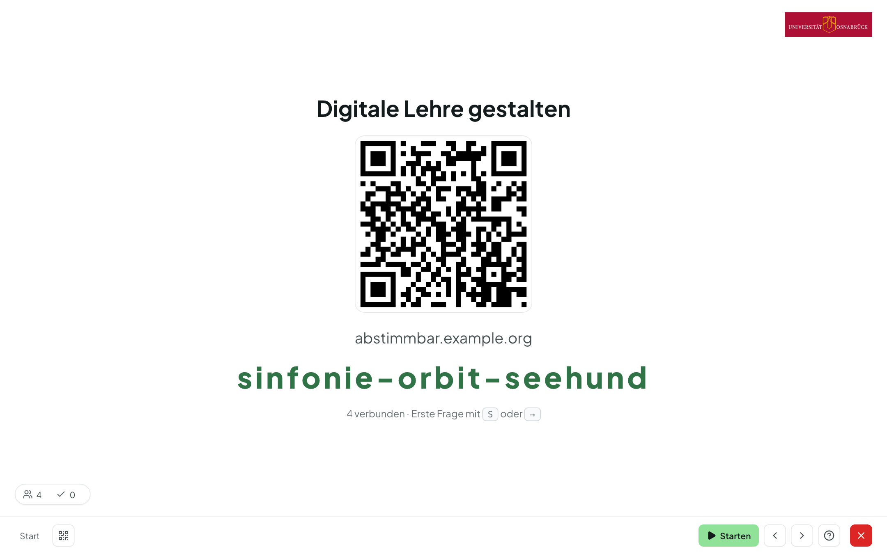

# Teilnehmende einladen

Die Teilnahme ist **anonym und ohne Konto**. Ihre Teilnehmenden gelangen auf
zwei Wegen zur Abstimmung:

- über den **QR-Code**, den der Präsentationsmodus einblendet, oder
- über den **Raumcode bzw. die Kurz-URL**, die Sie ansagen können. Der
  Raumcode lässt sich auch auf der Startseite von Abstimmbar unter
  **„An einer Abstimmung teilnehmen“** eingeben.

Mit dem QR-Symbol (Taste ++q++) blenden Sie QR-Code und Raumcode während der
Präsentation jederzeit wieder ein. In den
[Raum-Einstellungen](raeume.md#raum-einstellungen-experten-modus) können Sie
beides auch **dauerhaft** in einer Ecke einblenden, damit später
Hinzukommende jederzeit beitreten können.

## Was Teilnehmende sehen

- Die Teilnahmeseite ist bewusst schlank und läuft in jedem Browser — eine
  App ist nicht nötig. Oben rechts wählen Teilnehmende Deutsch oder Englisch.
- Bis Sie eine Frage starten, sehen die Teilnehmenden nur die Frage
  („Die Abstimmung hat noch nicht begonnen.“); danach können sie antworten.
- Die Seite folgt Ihrer Präsentation von selbst: Wechseln Sie die Frage,
  wechselt auch das Gerät der Teilnehmenden.
- Unter **Meine Antworten** sehen Teilnehmende, was sie in dieser Runde
  geantwortet haben.
- Ob Teilnehmende die Ergebnisse und die Lösung auch auf dem eigenen Gerät
  sehen, legen Sie in den
  [Einstellungen der Live-Umfrage](set-arten.md#live-umfrage) fest.
- Nach dem Ende sehen Teilnehmende den Schlussbildschirm und, falls
  eingerichtet, Ihre **Abschluss-Info**.
