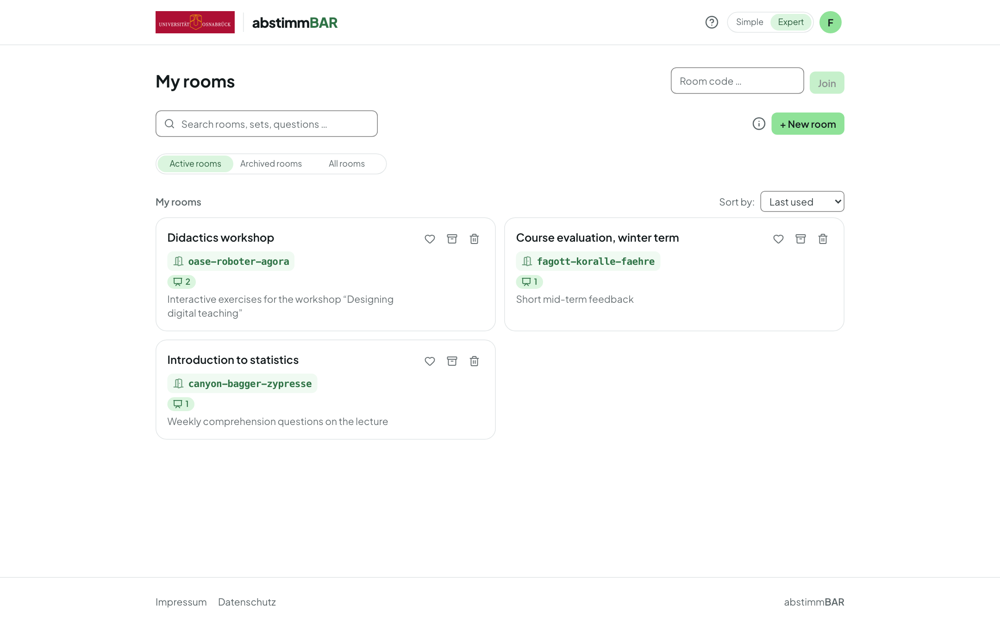

# Guide for teachers

Abstimmbar is an anonymous live voting system for your teaching. You ask
questions, your participants answer on their own smartphone or laptop —
without signing in — and the results appear on the projector right away.

This guide takes you from signing in to evaluating the results. Once signed
in as a teacher, you can also start a [guided tour](guided-tour.md) of the
interface at any time — via the **?** icon at the top right of the header.

## Chapters

-   :material-login: **[Sign-in and modes](sign-in.md)**

    Single sign-on, simple and expert mode, language and appearance.

-   :material-map-marker-path: **[The guided tour](guided-tour.md)**

    All key features in a few minutes, using the example room.

-   :material-door: **[Rooms](rooms.md)**

    The permanent access point for your course — with a fixed code.

-   :material-shape-outline: **[Types of question sets](set-types.md)**

    Live poll, self-paced quiz or self-check — what fits when.

-   :material-pencil-box-multiple: **[Creating questions](questions.md)**

    Sections, ten question types, before/after questions, import and export.

-   :material-creation: **[AI assistance](ai-assistance.md)**

    Optional suggestions — you decide what to use.

-   :material-play-circle: **[Starting a run](runs.md)**

    Present, start a quiz, publish a self-check.

-   :material-qrcode: **[Inviting participants](inviting-participants.md)**

    QR code, room code and what participants see.

-   :material-projector-screen: **[Presenting](presenting.md)**

    Controls on the projector, word cloud, mind map, four-field matrix.

-   :material-video: **[Recorded lectures](recorded-lectures.md)**

    Voting afterwards via a QR code per question.

-   :material-chart-bar: **[Results](results.md)**

    Runs, CSV export, archiving and deleting.

-   :material-account-group: **[Rooms as a team](team.md)**

    Edit and present rooms together.

-   :material-school: **[In the learning platform](lms.md)**

    Launch from Moodle (Stud.IP as soon as it supports LTI 1.3).

-   :material-translate: **[Bilingual content](bilingual-content.md)**

    Interface and content in German and English.

-   :material-shield-check: **[Privacy](privacy.md)**

    Anonymous by design — and what the AI gets to see.

Finally: [Teaching tips](teaching-tips.md).
