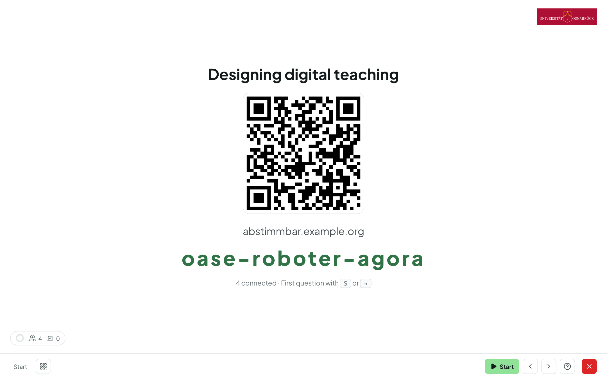
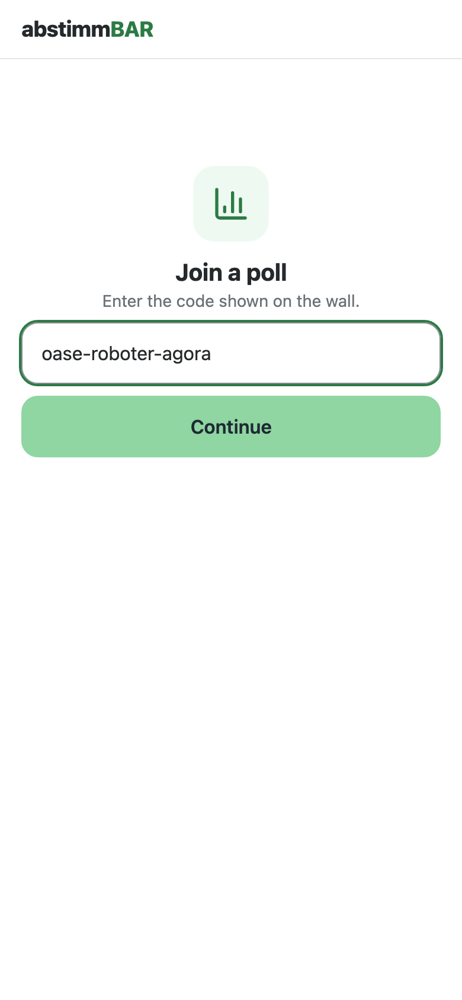

# Inviting participants

Participation is **anonymous and needs no account**. Your participants can
reach the vote in two ways:

- via the **QR code** shown in presentation mode, or
- via the **room code or short URL**, which you can read out. The room code
  can also be entered on the Abstimmbar home page under
  **“Join a vote”**.

The QR icon (key ++q++) brings the QR code and room code back at any time
during the presentation. In the
[room settings](rooms.md#room-settings-expert-mode) you can also show both
**permanently** in a corner, so that latecomers can join at any time.

## What participants see

- The participant page is deliberately lightweight and runs in any
  browser — no app needed. At the top right, participants can choose German
  or English.
- Until you start a question, participants only see the question
  (“The vote has not started yet.”); after that they can answer.
- The page follows your presentation automatically: when you move to another
  question, participants' devices move along with you.
- Under **My answers**, participants see what they have answered in this
  round.
- Whether participants also see the results and the solution on their own
  device is set in the
  [live poll settings](set-types.md#live-poll).
- After the end, participants see the closing screen and, if you have set
  one up, your **closing info**.
