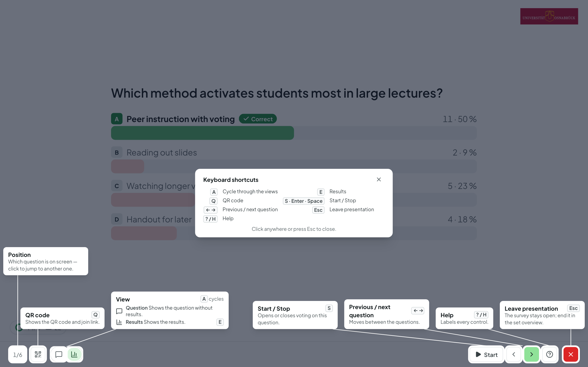
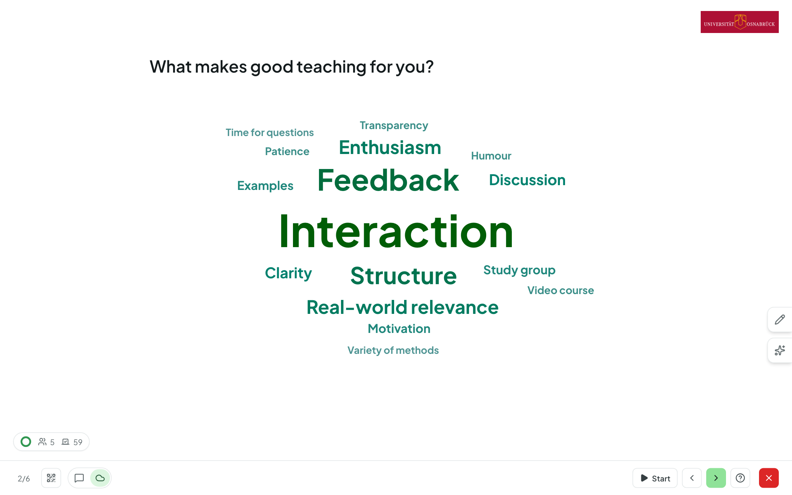
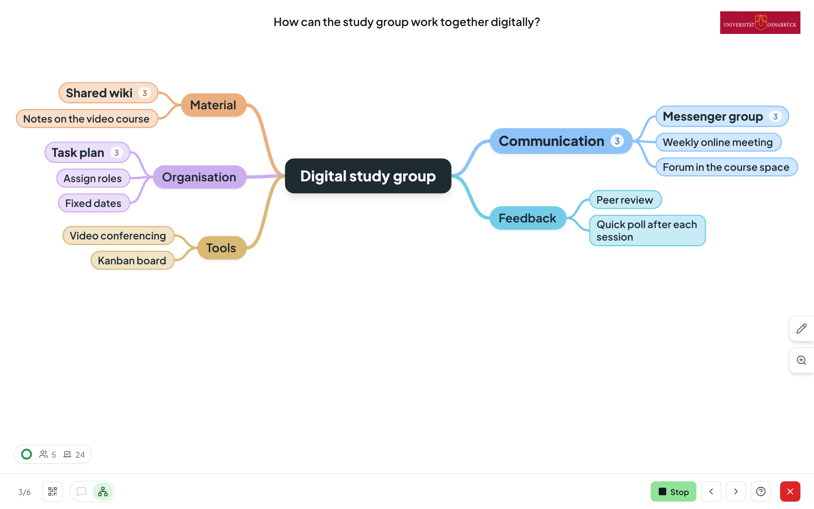
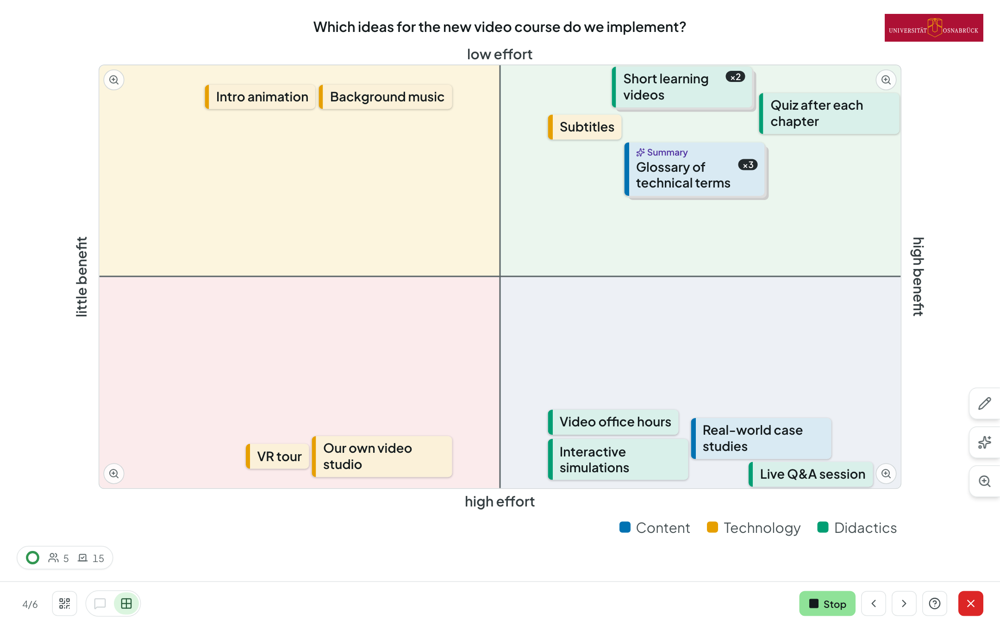
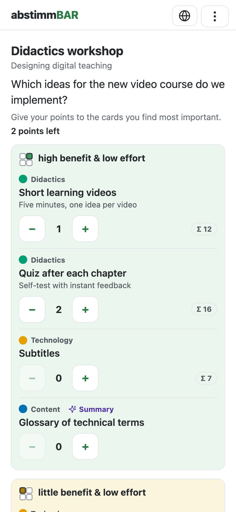
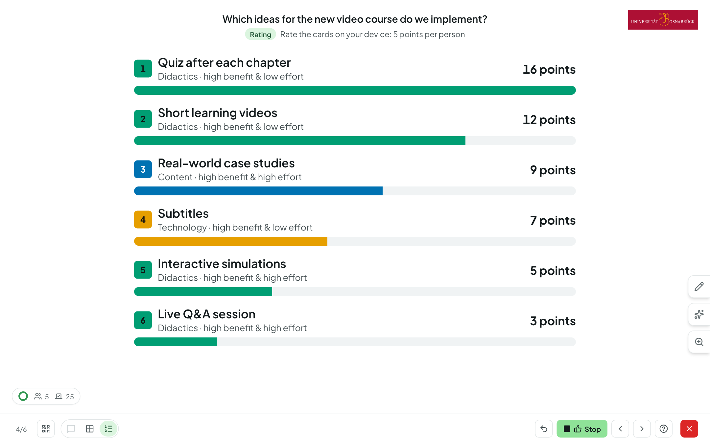
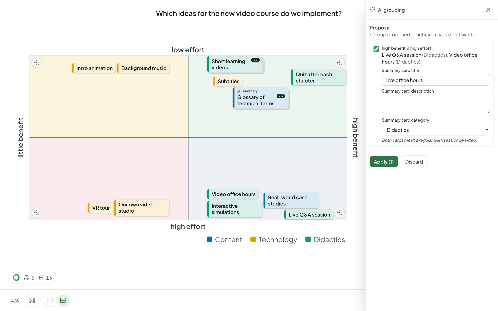

# Presenting

In presentation mode, you control the session via the toolbar at the bottom
or with the keyboard. The bar only shows what fits the current moment; hover
over an icon and a tooltip tells you its name and its key.

## The footer bar

- On the left is the **position** (e.g. “3/12”). Clicking it opens a list of
  all questions from which you can **jump straight to another question**.
- Next to it, the **QR icon** (++q++) brings back the QR code and room code
  at any time.
- **Start** (++s++, also ++enter++ or the space bar — handy with a
  presentation clicker) opens voting on the current question, **Stop**
  (++s++) closes it. Until you start, participants only see the question.
- **‹ ›** or ++arrow-left++ ++arrow-right++ go to the previous or next
  question.
- On the far right, **?** (++h++) opens the [help](#help), and the red **✕**
  (++esc++) [leaves the presentation](#leave-or-end).

At the bottom left, a small indicator shows the **connected participants**
and the **votes cast**. A coloured ring shows the share who have already
answered: red below 50 %, yellow up to 80 %, light green up to 95 %, dark
green above that; once everyone has answered, it briefly lights up.

## Views: question, results, solution

With the **view switcher** next to the QR icon, you decide what the projector
shows: the **Question**, the **Results** and — if the question has a correct
answer and the solution is set to appear “after closing” — the
**Solution**. Word clouds, free text and mind maps bring their own views here
(e.g. Original, Cleaned up and Grouped, Evaluation or Ranking). Results
update **in real time**; the bars build up with a short animation, and each
answer has its own colour. In the solution view, the correct answer is
marked **green** with “Correct”, the others turn a soft pink.

- ++e++ jumps to the results (closing any vote in progress); pressing ++e++
  again returns to the question.
- ++l++ shows the solution, pressing ++l++ again hides it.
- ++a++ cycles through the views. ++a++ is purely a “viewing” key: it never
  closes a vote in progress.

For [before-after questions](questions.md#before-after-questions-expert-mode),
the two results are shown side by side. If
[sections](questions.md#sections-expert-mode) structure your set, an
interstitial slide with the section's title and description appears before
each section; ++s++ or ++arrow-right++ brings up the first question.

## Keys at a glance

| Key | Action |
|---|---|
| ++s++, ++enter++, space bar | Start / stop voting |
| ++arrow-left++ ++arrow-right++ | Previous / next question |
| ++e++ | Results (closes a vote in progress) / back to the question |
| ++l++ | Show / hide the solution |
| ++a++ | Cycle through views |
| ++q++ | QR code and room code |
| ++h++ or ++"?"++ | Help |
| ++esc++ | Leave the presentation |
| ++ctrl+z++ / ++cmd+z++ | Undo the last moderation step (mind map) |

## Help { #help }

On the far right, **?** (or ++h++) opens the **Help**: the screen is dimmed,
and every currently visible button and every tab on the right-hand edge is
labelled with what it does and which key goes with it; all keys are listed
at a glance at the bottom centre. A click, ++esc++, **?** or ++h++ closes
the help again.

## Leave or end { #leave-or-end }

- The red **✕** (++esc++) **leaves** the presentation without ending the
  survey: any vote in progress is closed, you return to the question set's
  overview, and participants see “The presentation is paused – more
  questions may follow.” (with a button to view their answers).
- **Resume:** if you present again within two hours, you pick up where you
  left off — for a matrix or mind map, you go straight to the board or mind
  map; as soon as you start a new vote, participants' devices jump to the
  question automatically.
- If you press ++arrow-right++ past the last question, the **closing screen**
  appears; any key then ends the survey, and ++arrow-left++ takes you back to
  the last question.
- **End survey:** while a run is in progress, the question set's overview
  shows the **End survey** button. Participants then see the closing screen;
  the results are kept.

## Word cloud

The cloud grows live as answers come in (if enabled in the editor) —
frequent terms appear larger. Abstimmbar merges identical terms on its own,
regardless of upper or lower case.

### Merging and hiding terms (expert mode)

Participants often mean the same thing with different words (“feedback”,
“response”). You can merge such terms right on the projector:

- **Merge:** drag one term onto another. Both then appear as a single term
  with the sum of their mentions.
- **Hide:** hover over a term and click **×** — for example for
  inappropriate entries.
- **Moderation list:** the **pencil** on the right-hand edge opens the list
  of your interventions. Under **Hidden**, you bring terms back with **Show
  again**. Under **Merged** you'll find your merges: you can **rename** them
  (this is how they appear on the projector) or **undo** the merge, so the
  terms appear separately again.

All interventions are reversible and don't change any votes. They apply to
this run everywhere: on the projector, on participants' devices, on the
results page and in the CSV export.

### Cleaning up and grouping with AI (expert mode)

If AI is set up at your institution and you have switched on **“Clean up
word cloud with AI (presentation)”** for the question in the editor, two
more views are added to the view switcher:

- **Cleaned up** — the AI merges similar terms. What it may merge is set
  under the **star** on the right-hand edge: **Spelling variants and typos**
  (müde / muede / mühde), **Synonyms and word forms** (einsam / Einsamkeit)
  and, if you wish, **Similar concepts** (Gebäude / Haus / Wohnung). **Merge
  again** applies changed settings.
- **Grouped (AI)** — the AI assigns the terms to topics. You can adjust the
  **Grouping instruction** (e.g. “by teaching format”) on the fly in the star
  panel; **Regroup** applies it.

**Original** shows the cloud without AI again at any time. The AI views don't
change any votes; the settings are saved with the question. On the
[results page](results.md), too, you can **Optimize with AI** a word cloud
afterwards and switch between the original and the optimized version.

## Free text

In expert mode, free-text answers can be handled in the same way. In the
view switcher, you choose **Answers** (the answers themselves),
**Evaluation** (bars of the AI evaluation, if switched on), **Key
statements** (the AI combines identical statements with a count) and
**Grouped** (key statements organized by your instruction, e.g. “correct /
incorrect”; optionally taking the model solution into account, which stays
collapsed in the panel). The projector shows verbatim answers only in
“Answers”; if the answers have been evaluated, “Evaluation” comes first in
the switcher.

## Mind map { #mind-map }

The mind map grows live as answers come in. Use the mouse wheel and drag to
zoom and pan; the zoom tab on the right-hand edge switches between
**compact** and **detailed** (with descriptions).

### Moderating (expert mode)

You moderate the mind map right on the projector:

- With **+** on a term, you add a sub-term when someone calls one out.
- Drag a term **onto** another and the two are merged (sub-terms come
  along); drag it onto the **“Attach here”** zone beside it and it moves
  there together with its subtree.
- Double-click to rename a term; × hides it along with its subtree.
- ++ctrl+z++ / ++cmd+z++ undoes the last step.

The **pencil** on the right-hand edge opens the **moderation view**: under
**Hidden** you bring hidden terms back, and below that **Merged**, **Moved**,
**Renamed** and **AI changes** list your interventions so far (newest first).
**Reset** lets you selectively undo a single one of them, even an older one,
without touching the later ones. If it no longer fits because the mind map
has changed since, it says “No longer possible” with the reason, and nothing
changes. Resetting is locked during the rating.

### Optimizing with AI (expert mode)

If AI is set up at your university and you have switched on **Enable AI
features** for the mind map in the editor, a **star** appears below the
pencil. There you decide what the AI may do — **merge duplicates and
synonyms**, **unify the language** (target language German or English) and
**restructure** (move terms under more fitting branches, create new parent
terms) — and click **Optimise mind map** (from three terms onwards, not
during the rating). Only the question, the terms and their descriptions are
sent to the AI model.

The projector then shows a **preview** of the optimized tree: changed terms
have a purple outline, and an icon with a tooltip tells you what happened
(merged, renamed, moved, new parent term). On the right, all suggestions are
listed with checkboxes; if you untick one, the suggestions that build on it
are dropped too, and the preview adjusts. **Apply** applies the selected
changes in one go — everyone sees the new tree immediately — and **Discard**
leaves everything as it was. ++ctrl+z++ / ++cmd+z++ undoes the whole change
at once. The AI keeps terms that you created or predefined; nothing is
deleted or hidden.

### Rating

If you have set up a **Rating phase** in the editor, first stop collecting
and then click **Start rating** at the bottom. Your participants now rate the
terms on their devices — either with **Points** (a budget per person,
optionally several points per term) or with **👍/👎** (up to a set number of
ratings). No new terms are added in this phase; the counter at the bottom
left shows how many have already rated.

**Stop** (++s++) ends the rating; the results stay hidden until you reveal
them with **Results** (++e++) — unless you have switched on “Show ratings
during the rating” (then stopping leads straight to the results). This also
applies if you then go **Back to collecting**: as long as there are hidden
ratings, stopping and the timer running out only close voting, the mind map
stays on screen, and ++a++ shows no ratings either — only **Results** (++e++)
reveals them.

As soon as the results are visible, the mind map shows the points or
plus/minus on each term: each term fills up like a bar — for points in
proportion to the top-rated term, for plus/minus green from the left
(approval) and pink from the right (disapproval) — well-rated terms grow
larger, and the **Ranking** view lists the top terms as bars in the colour
of their branch.

During the rating, you can only hide and show terms; with **Back to
collecting**, participants can add terms again (the ratings are kept). If
you present an unfinished survey again later (a new session), the mind map
starts again with collecting. On the results page, the ratings appear on the
term tree, as a ranking and in the CSV export.

## Four-field matrix

Cards appear live on the axes; the projector shows the board while voting is
open and in the results view. The footer bar switches between **Question**
and **Matrix** (++a++ changes the view, ++e++ goes to the matrix); stopping
(++s++) or ++e++ leaves the board on screen. You moderate right on the
projector:

- **Drag:** cards can be dragged with the mouse or a finger. A card only
  changes field once you drag it clearly across a boundary (otherwise it
  slides back into its field); the target field lights up while you drag.
- **Stack:** drop one card onto another and the two form a stack (“×2”,
  “×3” …) — handy for identical or similar contributions.
- **Open:** clicking a card opens it with its description and, for a stack,
  all the cards it contains; there you can **Unstack** cards, **Hide** or
  **Show** a card, and delete your own cards. Hiding cards is reversible.
- **Your own cards:** the pencil on the right-hand edge adds a teacher's
  card (e.g. as an anchor or example) — you pick the field just like
  participants do, on the small set of axes — and can **Show hidden cards**.
- **Display:** cards have a tab on the left in the colour of their category
  (with a letter for colour categories). With many cards, they all
  automatically get a little smaller and spread out so they don't overlap.
  The tab with the display icon switches between **Compact** and
  **Detailed** (with descriptions). Clicking a category in the legend hides
  or shows its cards.
- **Zoom:** as with the mind map, you can zoom the whole board (mouse wheel,
  ++"+"++ / ++"−"++, tab) and pan it by dragging on an empty area or with
  ++shift++ + arrow keys; ++0++ fits it back in. The magnifier in the corner
  of a field shows that field full-screen; with ++","++ and ++"."++
  (alternatively ++"["++ and ++"]"++, or the arrows in the bar at the top)
  you move to the previous or next field, and ++esc++ or **Overview** takes
  you back.
- **Keyboard:** ++tab++ takes you to the cards, ++enter++ opens a card, and
  the arrow keys move it (++shift++ for bigger steps). A mouse click ends
  keyboard control again. **?** labels all the controls.

### Rating

If you have set up a rating phase in the editor, first stop collecting
(++s++); then **Start rating** appears at the bottom. Participants now rate
a list of the cards on their smartphones, grouped by field — for a stack,
only the top card, with no hint of the ones underneath — either with
**Points** (a budget per person) or with **👍/👎**. The counter at the bottom
left shows how many have already rated.

{ .ab-phone }

The results stay hidden until you reveal them with **Results** (++e++)
(unless interim results are switched on). After that, each card fills up
like a bar (points in proportion to the top-rated card, for plus/minus green
from the left and pink from the right) with the number beside it, and the
**Ranking** view lists the best-rated cards. Cards don't get bigger as a
result.

During the rating, **stacks are locked** (dragging only moves the card;
participants can't add or withdraw cards); moving and hiding are still
possible. **Back to collecting** opens the board again; the ratings are kept
and stay hidden: stopping (++s++) and the timer running out then only close
voting, the board stays on screen, ++a++ shows no ratings — only **Results**
(++e++) reveals them.

If you return to the presentation in the same session, the matrix is still
in the rating; if you present an unfinished survey again later (a new
session), it starts again with collecting.

### AI grouping (expert mode) { #ai-summarize-expert-mode }

If AI is set up at your university and you have switched on **Enable AI
features** for the matrix in the editor, a **star** appears below the
pencil. There you first choose how strictly the AI should work:

- **Spelling only** — typos, upper/lower case, singular/plural,
- **Same content** — the same content in different words,
- **Conceptually similar** — a common theme.

**Get proposal** (from three cards onwards) shows the suggested groups —
always only cards from **the same field**. Each group gets a **summary
card**: the AI suggests its title (and, if switched on, description and
category), and you can change them before applying. The summary card sits on
top of the stack, in the place of the oldest card; the other cards lie
underneath. If a group already has a summary card, it stays (no second one).
Groups that no longer fit the board (a card hidden, in different fields …)
are greyed out and give the reason.

Matching cards in different fields are pointed out by the AI as a hint —
depending on the chosen level under **Same spelling, but placed
differently**, **Same content, but placed differently** or **Similar, but
placed differently**. **Highlight** marks these cards on the board without
changing anything — a good starting point for discussion.

**Across field boundaries:** if you switch on **Also group across fields**
before **Get proposal**, groups may contain cards from several fields: the
summary card goes into the field with the most cards of the group (in a tie,
into the field of the oldest card), cards from other fields are marked
**will be moved from: …** and are moved there together with their stack when
you apply; hints are then omitted. The switch is off by default.

**Apply** stacks all ticked groups in one step; **Undo** in the panel
reverts exactly this step (moved cards return to their field and their
position) — until the next apply or until you close the panel (opening the
pencil or display tab also closes it), and only as long as the stacks
haven't been changed by hand.

**Summary cards** carry a star and “Summary” on the projector, on the
results page and in participants' rating list; they can be rated like any
other card, and the number on the stack (“×3”) only counts the cards
underneath. If you fully dissolve a stack by hand, its summary card
disappears.

Only content is sent to the AI model — the question, axes, field names and
the cards (title, description, category) — no names or other data about the
participants. During the rating the star is locked, because the stacks are
fixed in this phase; an open panel closes.

## Logo

Whether your institution's logo appears in presentation mode is set in the
[room settings](rooms.md#room-settings-expert-mode).
