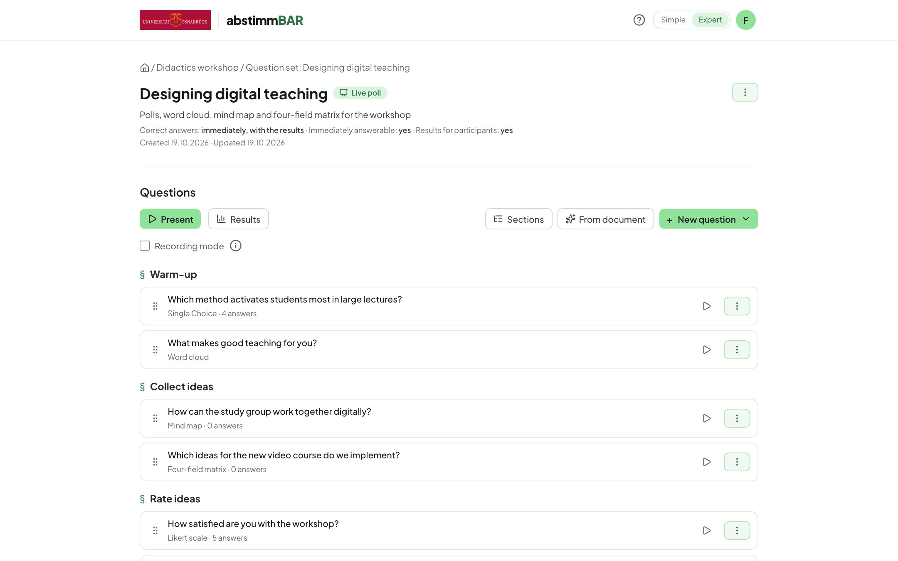
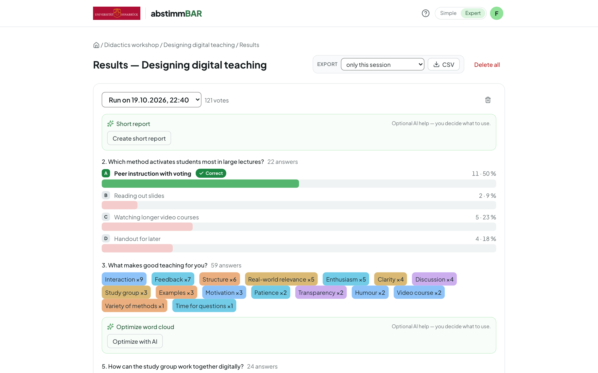

Open source · virtUOS, Osnabrück University

<h1 class="ab-hero__title">The whole lecture hall takes part — anonymously, no app needed.</h1>

Abstimmbar brings live voting into your teaching: you put questions on the
projector, and your participants answer on their own smartphones by scanning
a QR code — no account, nothing to install. From a quick single-choice
question to a mind map the whole group builds together.

[Guide for teachers](guide/index.md){ .md-button .md-button--primary }
[:fontawesome-brands-github: Source code on GitHub](https://github.com/virtUOS/abstimmbar){ .md-button }

<figure class="ab-shot ab-shot--hero" markdown>

</figure>

<ul class="ab-facts">
  <li><strong>Anonymous</strong>no account, no IP addresses of voters</li>
  <li><strong>Ten question types</strong>from quizzes to the four-field matrix</li>
  <li><strong>LTI 1.3</strong>integration into learning platforms such as Moodle</li>
  <li><strong>1000 simulated participants</strong>at the same time in the load test</li>
  <li><strong>German &amp; English</strong>interface and content</li>
</ul>

## What Abstimmbar can do { .ab-section-title }

One tool for a quick question in between, for quiz phases where everyone works on their own, and for ideas the whole group collects and rates together.

### Quizzes and polls, live on the projector

Single and multiple choice, yes/no, Likert scale, priorities and ordering.
Results appear in real time; you reveal the correct answer immediately,
after closing the question, or never.

### Word cloud and free text

Terms grow into a cloud live, and spelling variants are merged. You moderate
right on the projector — merge, hide, rename.

### Mind map and four-field matrix

Collect and organise ideas together: as a tree of terms, or as cards between
two axes such as effort versus benefit. Cards can be dragged, stacked and
grouped.

### Rate together

If you like, collecting is followed by a rating phase with points or
plus/minus. The ranking shows what matters most to the group.

### Join with your own device

Scan the QR code or enter the room code — done. The lightweight participant
page runs in any browser and follows your presentation automatically.

### AI assistance — optional

Suggest distractors, generate questions from slides, tidy up word clouds,
summarise cards. Every suggestion is just a suggestion; your institution
decides whether a model is used, and which one.

### Live poll, self-paced quiz or self-check

You lead live polls question by question. Self-paced quizzes run at each
participant's own pace, and self-checks are available via a permanent link
with instant feedback.

### Results and export

Every run is saved and can later be compared, exported as CSV or archived —
rooms and codes stay the same across semesters.

-   :material-keyboard-outline: __Made for the projector__

    A footer bar with tooltips, keyboard shortcuts for presenters, a jump
    menu and a help overlay that labels every control.

-   :material-translate: __Bilingual__

    Interface in German and English; questions and answers can be stored in
    both languages. [More on bilingual content](guide/bilingual-content.md)

-   :material-account-group-outline: __As a team__

    Share rooms with colleagues, pass on question sets via a link, export and
    import them as JSON.

-   :material-video-outline: __Recordings__

    In recording mode, every question carries its own QR code — anyone
    watching the recording later can still vote.

## Who it's for { .ab-section-title }

-   :material-human-male-board: __Teachers__

    ---

    For lectures, seminars and workshops: gauge prior knowledge, check
    understanding, spark discussions, collect ideas. A [guided
    tour](guide/guided-tour.md) and an example room make it easy to get
    started.

    [:octicons-arrow-right-24: To the guide](guide/index.md)

-   :material-school-outline: __Students__

    ---

    Take part without an account and without an app, on your own smartphone
    or laptop. Answers stay anonymous — ideal for honest feedback.

-   :material-server-network: __Universities and IT centres__

    ---

    Host it yourself with Docker Compose, sign in via your own identity
    provider (OIDC), integrate it into your LMS via LTI 1.3.

    [:octicons-arrow-right-24: To the installation guide](installation.md)

## Privacy and openness { .ab-section-title }

-   :material-incognito: __Anonymous by design__

    Participants don't need an account, and voters' IP addresses are not
    stored.

-   :material-robot-outline: __AI only if you want it__

    All AI features can be switched off and only run through the service
    your institution has configured — a self-hosted model is possible, too.
    Only content such as questions and answers is sent to the model — no
    names, identifiers or accounts of participants.

-   :material-scale-balance: __Open source__

    The complete source code is available under the Apache License 2.0 on
    [GitHub](https://github.com/virtUOS/abstimmbar) — to review, run and
    help develop.

-   :material-domain: __Made at a university__

    Developed by virtUOS at Osnabrück University — as the successor to the
    Stud.IP plugin Cliqr.

## Installation { .ab-cta__title }

Abstimmbar runs as a Docker Compose stack of PostgreSQL, Django and Caddy on
your own Linux server — with automatic HTTPS, sign-in via OIDC and optional
LMS integration. The step-by-step guide assumes no prior Linux experience.

[To the installation guide](installation.md){ .md-button .md-button--primary }
[LMS integration (LTI 1.3)](lti.md){ .md-button }

