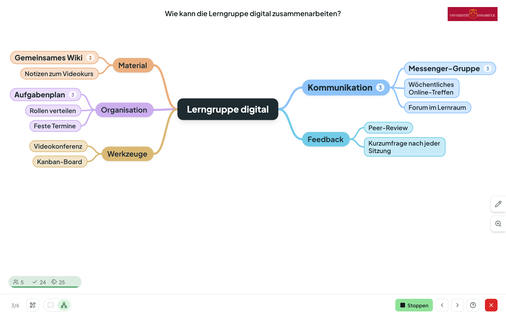
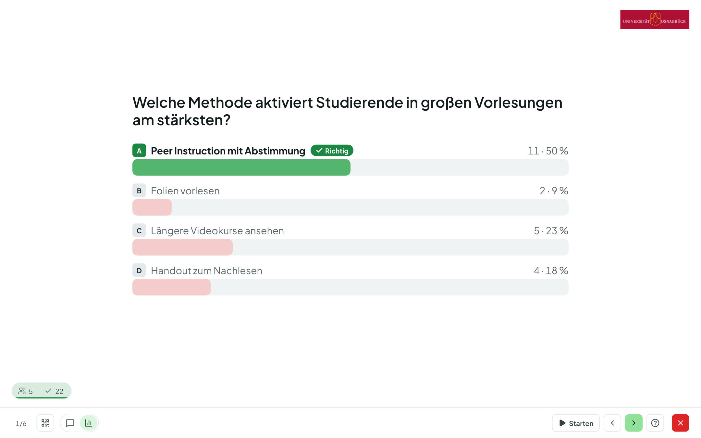
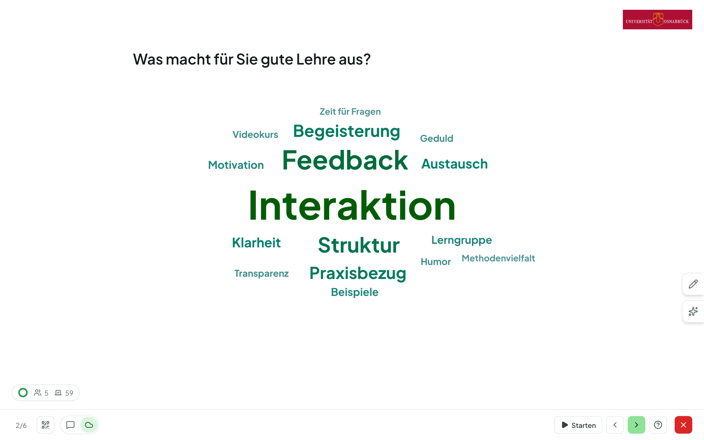
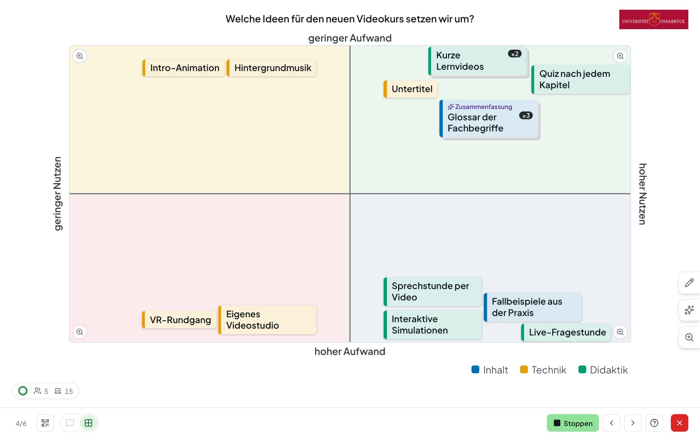
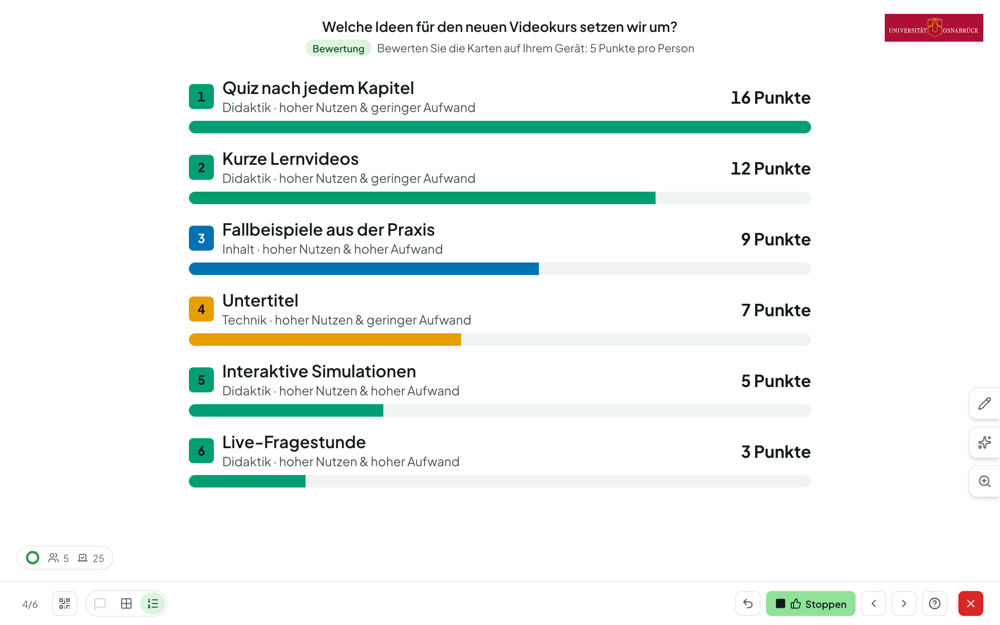
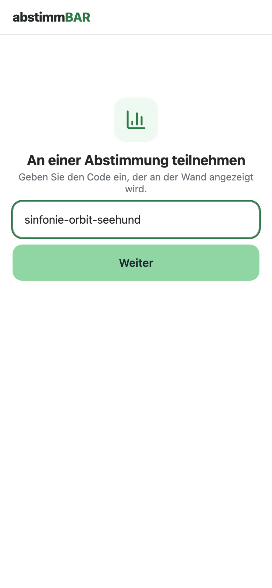
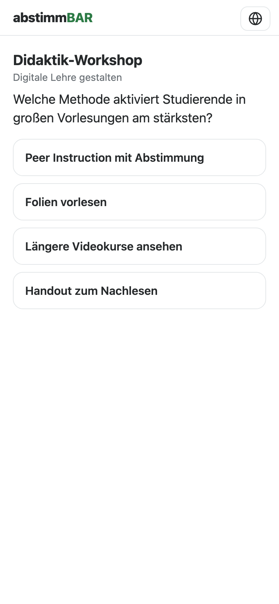
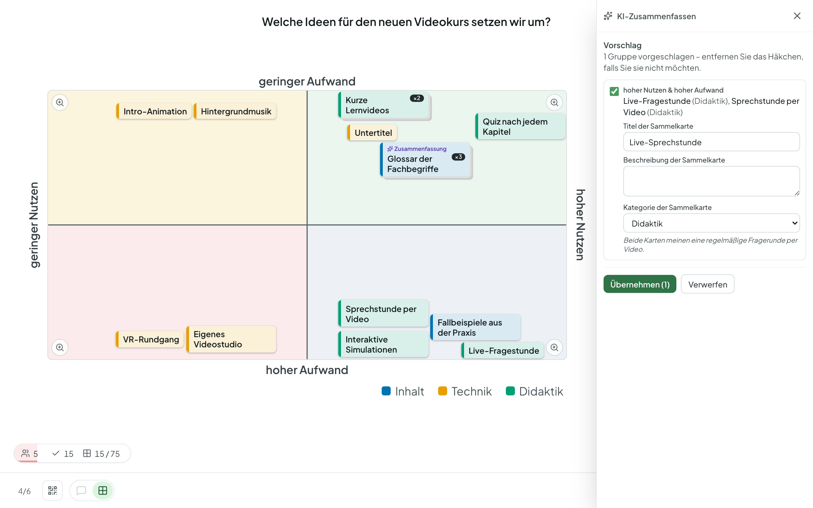
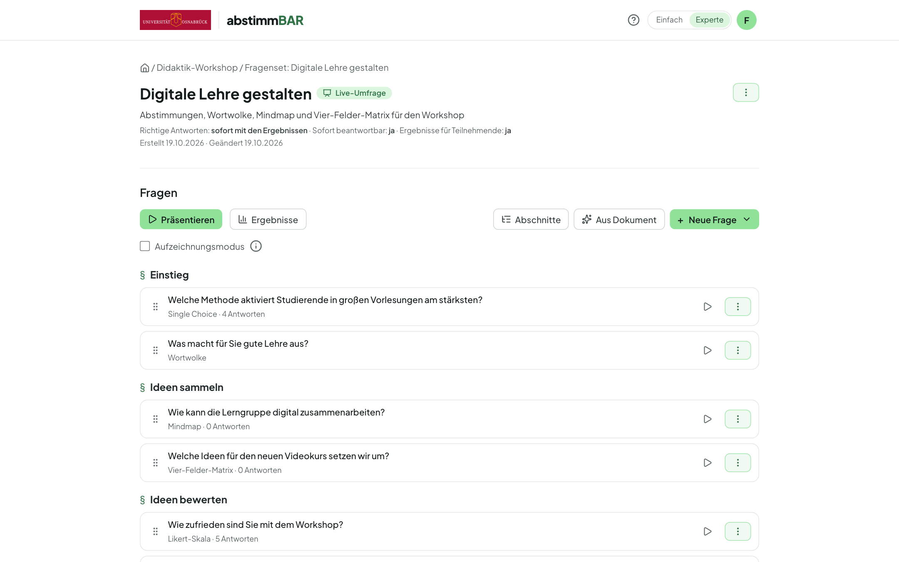
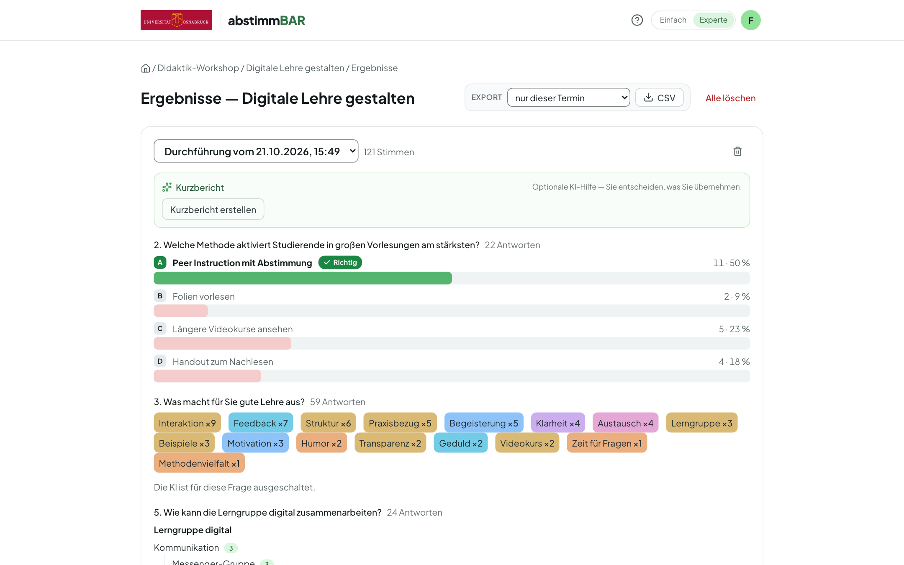

Open Source · virtUOS, Universität Osnabrück

<h1 class="ab-hero__title">Der ganze Hörsaal stimmt mit — anonym und ohne App.</h1>

Abstimmbar bringt Live-Abstimmungen in Ihre Lehrveranstaltung: Sie stellen
Fragen am Beamer, Ihre Teilnehmenden antworten per QR-Code mit dem eigenen
Smartphone — ohne Konto, ohne Installation. Von der schnellen Einzelauswahl
bis zur gemeinsam gebauten Mindmap.

[Anleitung für Lehrende](anleitung/index.md){ .md-button .md-button--primary }
[:fontawesome-brands-github: Quellcode auf GitHub](https://github.com/virtUOS/abstimmbar){ .md-button }

<figure class="ab-shot ab-shot--hero" markdown>

</figure>

<ul class="ab-facts">
  <li><strong>Anonym</strong>kein Konto, keine IP-Adressen der Abstimmenden</li>
  <li><strong>Zehn Fragetypen</strong>vom Quiz bis zur Vier-Felder-Matrix</li>
  <li><strong>LTI 1.3</strong>Einbindung in Lernplattformen wie Moodle</li>
  <li><strong>1000 simulierte Teilnehmende</strong>gleichzeitig im Lasttest</li>
  <li><strong>Deutsch &amp; Englisch</strong>Oberfläche und Inhalte</li>
</ul>

## Was Abstimmbar kann { .ab-section-title }

Ein Werkzeug für die schnelle Frage zwischendurch, für Quiz-Phasen in Stillarbeit und für Ideen, die die ganze Gruppe gemeinsam sammelt und bewertet.

### Quiz und Umfrage, live am Beamer

Einzel- und Mehrfachauswahl, Ja/Nein, Likert-Skala, Prioritäten und
Sortierung. Ergebnisse erscheinen in Echtzeit; die richtige Antwort decken Sie
sofort, nach dem Schließen oder nie auf.

### Wortwolke und Freitext

Begriffe wachsen live zur Wolke, Schreibvarianten werden zusammengefasst. Sie
moderieren direkt am Beamer — führen zusammen, blenden aus, benennen um.

### Mindmap und Vier-Felder-Matrix

Ideen gemeinsam sammeln und ordnen: als Begriffsbaum oder als Karten zwischen
zwei Achsen, etwa Aufwand gegen Nutzen. Karten lassen sich ziehen, stapeln
und gruppieren.

### Gemeinsam bewerten

Auf das Sammeln folgt auf Wunsch eine Bewertungsphase mit Punkten oder
Plus/Minus. Die Rangliste zeigt, was der Gruppe am wichtigsten ist.

### Teilnahme mit dem eigenen Gerät

QR-Code scannen oder Raumcode eingeben — fertig. Die schlanke Teilnahmeseite
läuft in jedem Browser und folgt Ihrer Präsentation von selbst.

### KI-Assistenz — optional

Distraktoren vorschlagen, Fragen aus Folien erzeugen, Wortwolken aufräumen,
Karten zusammenfassen. Jeder Vorschlag ist nur ein Vorschlag; die
Einrichtung entscheidet, ob und welches Modell genutzt wird.

### Live, Quiz-Block oder Lernkontrolle

Live-Umfragen steuern Sie Frage für Frage. Quiz-Blöcke laufen im eigenen
Tempo, Lernkontrollen über einen Dauer-Link mit sofortiger Rückmeldung.

### Ergebnisse und Export

Jede Durchführung bleibt gespeichert und lässt sich später vergleichen, als
CSV exportieren oder archivieren — Räume und Codes bleiben über Semester
gleich.

-   :material-keyboard-outline: __Für den Beamer gemacht__

    Fußleiste mit Tooltips, Tastenkürzel für Presenter, Sprungmenü und eine
    Hilfe, die jedes Bedienelement beschriftet.

-   :material-translate: __Zweisprachig__

    Oberfläche auf Deutsch und Englisch; Fragen und Antworten lassen sich in
    beiden Sprachen hinterlegen. [Mehr zur Zweisprachigkeit](anleitung/zweisprachigkeit.md)

-   :material-account-group-outline: __Im Team__

    Räume mit Kolleginnen und Kollegen teilen, Fragensets per Link weitergeben,
    als JSON exportieren und importieren.

-   :material-video-outline: __Aufzeichnungen__

    Im Aufzeichnungsmodus trägt jede Frage einen eigenen QR-Code — wer die
    Aufzeichnung später sieht, stimmt nachträglich ab.

## Für wen { .ab-section-title }

-   :material-human-male-board: __Lehrende__

    ---

    Für Vorlesung, Seminar und Workshop: Vorwissen abfragen, Verständnis
    prüfen, Diskussionen anstoßen, Ideen sammeln. Ein [geführter
    Rundgang](anleitung/rundgang.md) und ein Beispielraum erleichtern den
    Einstieg.

    [:octicons-arrow-right-24: Zur Anleitung](anleitung/index.md)

-   :material-school-outline: __Studierende__

    ---

    Mitmachen ohne Konto und ohne App, mit dem eigenen Smartphone oder Laptop.
    Die Antworten bleiben anonym — gut für ehrliches Feedback.

-   :material-server-network: __Hochschulen und Rechenzentren__

    ---

    Selbst betreiben mit Docker Compose, Anmeldung über den eigenen Identity
    Provider (OIDC), Einbindung ins LMS über LTI 1.3.

    [:octicons-arrow-right-24: Zur Installation](installation.md)

## Datenschutz und Offenheit { .ab-section-title }

-   :material-incognito: __Anonym by design__

    Teilnehmende brauchen kein Konto, und IP-Adressen der Abstimmenden
    werden nicht gespeichert.

-   :material-robot-outline: __KI nur, wenn gewollt__

    Alle KI-Funktionen sind abschaltbar und laufen nur über den Dienst, den
    Ihre Einrichtung konfiguriert — auch ein selbst betriebenes Modell ist
    möglich. Ans Modell gehen nur Inhalte wie Fragen und Antworten – keine
    Namen, Kennungen oder Konten der Teilnehmenden.

-   :material-scale-balance: __Open Source__

    Der gesamte Quellcode steht unter der Apache-Lizenz 2.0 auf
    [GitHub](https://github.com/virtUOS/abstimmbar) — zum Prüfen, Betreiben
    und Mitentwickeln.

-   :material-domain: __Aus der Hochschule__

    Entwickelt von virtUOS an der Universität Osnabrück — als Nachfolger des
    Stud.IP-Plugins Cliqr.

## Installation { .ab-cta__title }

Abstimmbar läuft als Docker-Compose-Stack aus PostgreSQL, Django und Caddy
auf einem eigenen Linux-Server — mit automatischem HTTPS, Anmeldung über
OIDC und optionaler LMS-Anbindung. Die Schritt-für-Schritt-Anleitung setzt
keine Linux-Vorerfahrung voraus.

[Zur Installationsanleitung](installation.md){ .md-button .md-button--primary }
[LMS-Einbindung (LTI 1.3)](lti.md){ .md-button }

